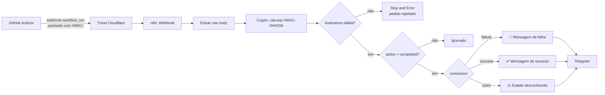

# Alertas de CI/CD com n8n

Sistema que recebe eventos do **GitHub Actions**, valida que vêm mesmo do GitHub e envia um alerta para o **Telegram** quando uma pipeline termina, com o resultado, o repositório, o branch, o commit e o link para a execução.

Construído com **n8n self-hosted em Docker**, exposto à internet através de um túnel da Cloudflare.

## Como funciona



1. O GitHub envia um evento `workflow_run` sempre que uma pipeline muda de estado (`requested`, `in_progress`, `completed`).
2. O n8n recebe o pedido e calcula a assinatura HMAC-SHA256 do corpo original com o secret partilhado.
3. Se a assinatura não bater certo com o header `x-hub-signature-256`, o pedido é rejeitado e fica registado como execução falhada.
4. Só os eventos `completed` seguem em frente. Os estados intermédios são ignorados.
5. O resultado (`conclusion`) decide a mensagem: falha, sucesso, ou estado desconhecido (`cancelled`, `timed_out`, etc.).
6. A mensagem é enviada pelo Telegram, com novas tentativas automáticas em caso de falha de rede.

## Decisões técnicas

| Decisão | Porquê |
| --- | --- |
| **Validação HMAC da assinatura do GitHub** | Sem ela, qualquer pessoa que descobrisse o URL do webhook podia enviar alertas falsos. |
| **HMAC calculado sobre o raw body** | A assinatura é feita sobre os bytes exatos que o GitHub envia. Voltar a serializar o JSON já interpretado pode mudar espaços ou ordem e invalidar a comparação. |
| **Secret guardado como credencial do n8n** | Fica cifrado na base de dados do n8n e não é incluído no workflow exportado. |
| **Filtrar apenas `action = completed`** | O GitHub envia vários eventos por pipeline, e nem sempre todos. O alerta não pode depender de quantos eventos intermédios chegam. |
| **Switch com saída de fallback** | Valores que não são `failure` nem `success` (`cancelled`, `timed_out`...) geram um aviso explícito, em vez de caírem num ramo errado e reportarem um resultado falso. |
| **Mensagem com repositório, branch, commit e link** | Um alerta só é útil se permitir agir de imediato. O mesmo workflow serve qualquer repositório. |
| **Retry no envio para o Telegram** (3 tentativas, 2 s) | Falhas temporárias de rede ou DNS não fazem perder alertas. |
| **DNS públicos no serviço do n8n** (`1.1.1.1`, `8.8.8.8`) | O DNS do router falhava com pedidos A e AAAA em simultâneo, o que dava `EAI_AGAIN` no Node.js. |
| **Versões das imagens fixadas no `.env`** | As atualizações passam a ser uma decisão explícita e não uma surpresa. |

## Estrutura do repositório

```
alertas-cicd/
├── workflows/
│   └── alertas-cicd.json      # workflow do n8n exportado (sem credenciais)
├── exemplo-pipeline/
│   └── teste.yml              # pipeline de teste do GitHub Actions
├── compose.yml                # stack do n8n em Docker Compose
├── .env.example               # variáveis necessárias, com valores de exemplo
└── README.md
```

## Pôr a correr

### Requisitos

- Docker Engine e Docker Compose
- `cloudflared` (para expor o n8n temporariamente)
- Uma conta do Telegram e um bot criado com o [@BotFather](https://t.me/BotFather)
- Um repositório no GitHub com GitHub Actions

### 1. Configurar e arrancar o n8n

```bash
cp .env.example .env
```

Preencher o `.env`:

- `N8N_VERSION`: última versão estável em https://github.com/n8n-io/n8n/releases
- os segredos internos da stack: um valor diferente para cada, gerado com `openssl rand -hex 32`
- `GITHUB_WEBHOOK_SECRET`: também gerado com `openssl rand -hex 32`

Validar a configuração e arrancar:

```bash
docker compose config --quiet && docker compose up -d
```

### 2. Expor o n8n com um túnel

```bash
cloudflared tunnel --url http://localhost:5678
```

Copiar o endereço `https://....trycloudflare.com` para o `.env`:

```
WEBHOOK_URL=https://o-teu-endereco.trycloudflare.com/
N8N_PROXY_HOPS=1
```

E recriar o contentor: `docker compose up -d`.

### 3. Importar o workflow e criar as credenciais

1. Em `http://localhost:5678`, importar `workflows/alertas-cicd.json`.
2. Criar as credenciais:
   - **Telegram:** o token do bot.
   - **Crypto:** o valor de `GITHUB_WEBHOOK_SECRET` no campo do HMAC.
3. No nó do Telegram, indicar o teu **Chat ID** (podes obtê-lo com o [@userinfobot](https://t.me/userinfobot)).
4. Publicar o workflow.

### 4. Configurar o webhook no GitHub

No repositório: **Settings → Webhooks → Add webhook**

| Campo | Valor |
| --- | --- |
| Payload URL | O **Production URL** do nó Webhook (`.../webhook/...`) |
| Content type | `application/json` |
| Secret | O valor de `GITHUB_WEBHOOK_SECRET` |
| SSL verification | Ativada |
| Events | Apenas **Workflow runs** |

### 5. Testar

Copiar `exemplo-pipeline/teste.yml` para `.github/workflows/teste.yml` no repositório, e depois em **Actions → Pipeline de teste → Run workflow**:

- com **falhar** marcado: deve chegar um 🚨
- sem **falhar**: deve chegar um ✅

Para confirmar que pedidos falsos são rejeitados:

```bash
curl -X POST "https://o-teu-endereco.trycloudflare.com/webhook/<path>" \
  -H "Content-Type: application/json" \
  -H "x-hub-signature-256: sha256=assinaturainventada" \
  -d '{"action":"completed","workflow_run":{"conclusion":"failure"}}'
```

O pedido deve parar no nó **Stop and Error**, sem enviar mensagem.

## Problemas encontrados e como os resolvi

| Sintoma | Causa | Solução |
| --- | --- | --- |
| `The DNS server returned an error` / `EAI_AGAIN` no Node.js | O DNS do router falhava com pedidos A e AAAA em simultâneo | `dns` com servidores públicos no serviço do n8n |
| GitHub recebia `404 webhook not registered` | Payload URL com `/webhook-test/` (só existe enquanto o editor está à escuta) | Usar o Production URL e publicar o workflow |
| GitHub recebia `Cannot POST /` | Payload URL só com o endereço do túnel, sem o caminho do webhook | Copiar o Production URL completo |
| Uma mensagem por cada estado da pipeline | O GitHub envia `requested`, `in_progress` e `completed` | Filtrar por `action = completed` |


